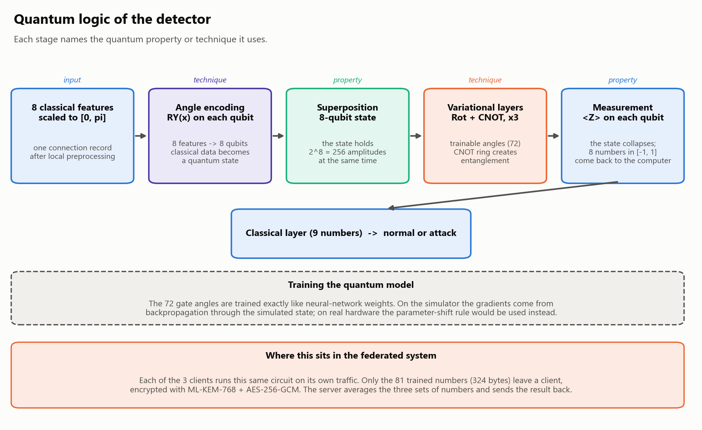

# Quantum ML Intrusion Detection with a Post-Quantum Secured Federated Channel

Three organisations train one network intrusion detector together without sharing a single
packet of traffic. Each trains a small quantum neural network on its own data and sends only
the 81 trained numbers to a server, and those numbers travel through a channel protected
with post-quantum cryptography, so an attacker who records them today still cannot read them
once quantum computers arrive.

Everything is simulated and reproducible from fixed seeds. The aim is not to claim a quantum
speed-up. It is to build the combination and **measure what the security actually costs**.


## Why

Pooling traffic from several organisations would make a detector much better, but connection
logs expose internal addressing and services and in many sectors cannot leave the building.
Federated learning solves that by moving the model instead of the data.

That leaves a second problem. Model updates leak information about the data behind them, so
the link carrying them needs protecting too, and today that protection rests on RSA or
elliptic-curve key exchange, both of which Shor's algorithm breaks on a large enough quantum
computer. An attacker needs no quantum computer now: recording the rounds is cheap, and an
update captured today still describes that network in ten years. A system that keeps traffic
local for privacy while protecting the channel with cryptography a quantum computer will
break is arguing with itself. This project removes that contradiction and prices it.

## What was built

|               |                                                                                                                |
| ------------- | -------------------------------------------------------------------------------------------------------------- |
| **Detector**  | Hybrid quantum neural network: 8 qubits, angle encoding, 3 strongly entangling layers, 81 trainable parameters |
| **Training**  | Federated learning across 3 non-IID clients, FedAvg, 30 rounds                                                 |
| **Channel**   | ML-KEM-768 (Kyber) key exchange, ML-DSA-65 signatures, AES-256-GCM, fresh handshake every round                |
| **Defence**   | Coordinate-wise median aggregation against a poisoning client                                                  |
| **Dataset**   | UNSW-NB15, 175,341 training and 82,332 testing records, 9 attack families                                      |
| **Simulator** | PennyLane `default.qubit`, exact expectation values                                                            |

## Results

| Model   | Setting                | Params | Sent/round |  Accuracy |    Recall |
| ------- | ---------------------- | -----: | ---------: | --------: | --------: |
| MLP     | Centralised            |    289 |          — |     81.6% |     99.1% |
| QNN     | Centralised            |     81 |          — |     80.4% |     99.1% |
| MLP     | Federated              |    289 |    1,156 B |     82.4% |     96.8% |
| **QNN** | **Federated**          | **81** |  **324 B** | **81.0%** | **97.8%** |
| QNN     | Federated + ML-KEM-768 |     81 |      324 B |     81.0% |     97.8% |

Three findings came out of the measurements:

**Encryption costs nothing in accuracy.** The same run under no encryption, X25519 and
ML-KEM-768 gives identical scores. The entire cost is **6,636 extra bytes and 0.24 extra
milliseconds per round**, against a round that takes about 19 seconds — roughly 0.03%.

**The signatures cost more than the post-quantum key exchange.** One ML-DSA-65 signature
takes 0.589 ms while the whole ML-KEM exchange takes under 0.180 ms. Optimising a pipeline
like this means looking at the signature scheme first, not the key exchange.

**Encryption cannot stop a dishonest client.** With one malicious client out of three,
plain averaging collapses to 44.1% accuracy and misses 2,739 of about 2,750 attacks, while
coordinate-wise median holds 78.9%. The malicious client has valid keys and its messages are
correctly signed and encrypted, so only the aggregation rule can stop it. Confidentiality
and honesty are separate problems needing separate defences.

The quantum model is **competitive, not better**: the classical federated model wins by 1.4
points, and a classical network with the same 81 parameters scores the same as the QNN. What
the quantum model wins on is size — 324 bytes per round against 1,156, which matters when
every round already carries a 9 KB handshake.

Ten attacks on the channel (man-in-the-middle, tampering, replay, impersonation, downgrade),
each run with both key exchanges and both signature schemes, give **40 checks that all pass**.

## How it works

1. **Split the raw data first.** The training file is divided across 3 clients before any
   preprocessing. Each attack family goes entirely to one client, so no client has ever seen
   another's attacks.
2. **Select 8 features, federated.** Clients score features with mutual information on their
   own data and send only the scores; the server combines them weighted by row count.
3. **Scale to [0, π], federated.** Clients send counts, minima and maxima. Every feature
   value becomes a rotation angle, identical at every client.
4. **Run the circuit.** Eight `RY` rotations encode the features, three entangling layers
   (72 trainable angles plus a CNOT ring) process them, `⟨Z⟩` is measured on each qubit, and
   one classical layer with 9 parameters produces the decision.
5. **Send the weights through the secure channel.** The server signs its ML-KEM-768 public
   key, the client verifies it against a key pinned before training began, and the update
   travels under AES-256-GCM.
6. **Aggregate.** FedAvg weights clients by data volume; the robust alternative takes the
   coordinate-wise median, which ignores data volume so a liar cannot buy influence.



## Layout

```
common/        settings, data loading, metrics
data/          raw CSVs, the 3 client splits, shared values, test set
federated/     feature selection and scaling, done by clients and server together
models/        classical networks, the quantum circuit, trained models
training/      centralised training
fl/            federated client, server, aggregation rules, runner
crypto/        the secure channel, its use in federated rounds, security tests
attacks/       the malicious client
benchmarks/    timing of each cryptographic operation
experiments/   live demo, verification, result tables and figures
results/       every table, figure and diagram
```

## Built with

PennyLane 0.45 (quantum circuits), PyTorch 2.14 (trains quantum angles and classical weights
with one optimiser), `cryptography` 50 via OpenSSL (ML-KEM-768, ML-DSA-65, X25519, Ed25519,
AES-256-GCM, HKDF), scikit-learn, pandas, NumPy, matplotlib.

No cryptographic primitive is hand-written. The federated layer is written by hand, so every
byte leaving a client is visible in the code and can be counted.


## References

1. M. U. Tanveer, S. R. Hassan and S. B. Belhaouari, "Federated digital twin with spatiotemporal learning and postquantum security for robust IIoT anomaly detection," _IEEE Internet of Things Journal_, vol. 13, no. 12, pp. 28031–28049, Jun. 2026.
2. D. Chaudhary, S. Rajasegarar and S. R. Pokhrel, "Towards adapting federated and quantum machine learning for network intrusion detection: a survey," arXiv:2509.21389, 2025.
3. N. Moustafa and J. Slay, "UNSW-NB15: a comprehensive data set for network intrusion detection systems," MilCIS, 2015.
4. NIST, FIPS 203 (ML-KEM) and FIPS 204 (ML-DSA), 2024.

## Author

K. Jaya Vishal — VIT Vellore.
Course project guided by Dr. Aswani Kumar Cherukuri.
