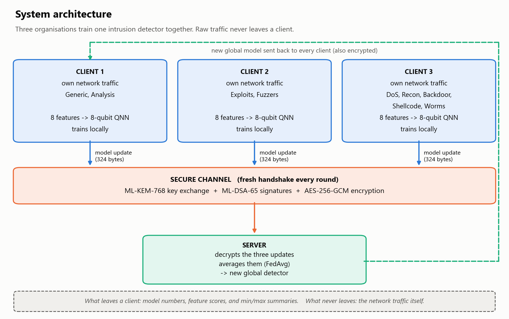

# Quantum Machine Learning Based Intrusion Detection with Post-Quantum Secured Federated Model Updates

Three organisations train one network intrusion detector together while every packet of their
traffic stays inside their own network. Each trains a compact quantum neural network on its own
data and sends only the 81 trained numbers to a server. Those numbers travel through a channel
protected with post-quantum cryptography, so they stay confidential even against a future
quantum-capable attacker.

Everything is simulated and fully reproducible from fixed seeds, and every cost of the security
layer is **measured, not estimated**.



## Why

Pooling traffic from several organisations makes a detector much stronger, and federated
learning makes that possible by moving the model instead of the data, so connection logs never
leave the building.

This project takes the next step and secures the model updates themselves. It replaces
classical key exchange with NIST-standardised post-quantum cryptography, so updates captured
today remain protected in the future. The result is a system that is private by design and
quantum-safe end to end, with its full cost measured.

## What was built

|               |                                                                                                                |
| ------------- | -------------------------------------------------------------------------------------------------------------- |
| **Detector**  | Hybrid quantum neural network: 8 qubits, angle encoding, 3 strongly entangling layers, 81 trainable parameters |
| **Training**  | Federated learning across 3 non-IID clients, FedAvg, 30 rounds                                                 |
| **Channel**   | ML-KEM-768 (Kyber) key exchange, ML-DSA-65 signatures, AES-256-GCM, fresh handshake every round                |
| **Defence**   | Coordinate-wise median aggregation against a poisoning client                                                  |
| **Dataset**   | UNSW-NB15, 175,341 training and 82,332 testing records, 9 attack families                                      |
| **Simulator** | PennyLane `default.qubit`, exact expectation values                                                            |

## Results

| Model   | Setting                | Params | Sent/round |  Accuracy |    Recall |
| ------- | ---------------------- | -----: | ---------: | --------: | --------: |
| MLP     | Centralised            |    289 |          — |     81.6% |     99.1% |
| QNN     | Centralised            |     81 |          — |     80.4% |     99.1% |
| MLP     | Federated              |    289 |    1,156 B |     82.4% |     96.8% |
| **QNN** | **Federated**          | **81** |  **324 B** | **81.0%** | **97.8%** |
| QNN     | Federated + ML-KEM-768 |     81 |      324 B |     81.0% |     97.8% |

Key findings:

**Compact and efficient quantum model.** The federated QNN reaches 81.0% accuracy and 97.8%
recall with only 81 parameters, about 3.6× fewer than the classical network. Each update is
just 324 bytes against 1,156, which keeps every round lightweight.

**Post-quantum security with zero accuracy loss.** The same run under no encryption, X25519
and ML-KEM-768 gives identical scores. The full security cost is only **6,636 bytes and
0.26 milliseconds per round**, against a round of about 19 seconds — roughly 0.04%.

**Very fast post-quantum key exchange.** A complete ML-KEM-768 exchange takes under 0.190 ms.
The ML-DSA-65 signature (0.974 ms) is the largest single step, which gives a clear direction
for further optimisation.

**Robust against a malicious client.** With one poisoning client out of three, coordinate-wise
median aggregation keeps accuracy at **78.9%**, compared with 44.1% for plain averaging. Together
with the encrypted, signed channel, this gives both confidentiality and robustness.

**Secure channel fully verified.** Ten attacks on the channel (man-in-the-middle, tampering,
replay, impersonation, downgrade), each run with both key exchanges and both signature schemes,
give **40 checks, all passed**.

## How it works

1. **Split the raw data first.** The training file is divided across 3 clients before any
   preprocessing. Each attack family goes entirely to one client, giving a realistic non-IID setup.
2. **Select 8 features, federated.** Clients score features with mutual information on their
   own data and send only the scores; the server combines them weighted by row count.
3. **Scale to [0, π], federated.** Clients send counts, minima and maxima. Every feature
   value becomes a rotation angle, identical at every client.
4. **Run the circuit.** Eight `RY` rotations encode the features, three entangling layers
   (72 trainable angles plus a CNOT ring) process them, `⟨Z⟩` is measured on each qubit, and
   one classical layer with 9 parameters produces the decision.
5. **Send the weights through the secure channel.** The server signs its ML-KEM-768 public
   key, the client verifies it against a key pinned before training began, and the update
   travels under AES-256-GCM.
6. **Aggregate.** FedAvg weights clients by data volume; the robust alternative takes the
   coordinate-wise median, which gives every client equal influence.


## Layout

```
common/        settings, data loading, metrics
data/          raw CSVs, the 3 client splits, shared values, test set
federated/     feature selection and scaling, done by clients and server together
models/        classical networks, the quantum circuit, trained models
training/      centralised training
fl/            federated client, server, aggregation rules, runner
crypto/        the secure channel, its use in federated rounds, security tests
benchmarks/    timing of each cryptographic operation
experiments/   live demo, verification, result tables and figures
results/       every table, figure and diagram
```

## Built with

PennyLane 0.45 (quantum circuits), PyTorch 2.14 (trains quantum angles and classical weights
with one optimiser), `cryptography` 50 via OpenSSL (ML-KEM-768, ML-DSA-65, X25519, Ed25519,
AES-256-GCM, HKDF), scikit-learn, pandas, NumPy, matplotlib.

All cryptographic primitives come from the standard, well-tested OpenSSL library. The federated
layer is written by hand, so every byte leaving a client is visible in the code and can be counted.

## References

1. M. U. Tanveer, S. R. Hassan and S. B. Belhaouari, "Federated digital twin with spatiotemporal learning and postquantum security for robust IIoT anomaly detection," _IEEE Internet of Things Journal_, vol. 13, no. 12, pp. 28031–28049, Jun. 2026.
2. D. Chaudhary, S. Rajasegarar and S. R. Pokhrel, "Towards adapting federated and quantum machine learning for network intrusion detection: a survey," arXiv:2509.21389, 2025.
3. N. Moustafa and J. Slay, "UNSW-NB15: a comprehensive data set for network intrusion detection systems," MilCIS, 2015.
4. NIST, FIPS 203 (ML-KEM) and FIPS 204 (ML-DSA), 2024.

## Author

K. Jaya Vishal — VIT Vellore. This work is part of the course **Quantum Computing**, undertaken with Dr. Aswani Kumar Cherukuri.
